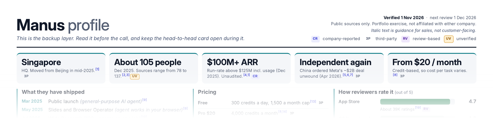

# 01 · Competitive Battlecard Generator



**A Claude skill that turns two company names into a fully sourced, sales-ready battlecard pack (PDF):** competitor profile, live-call card, proof and data card, answer key, and a clickable source log.

**Worked example:** Genspark vs Manus. See [`example-output/genspark-vs-manus-battlecards.pdf`](example-output/genspark-vs-manus-battlecards.pdf). It uses public information only, as a portfolio exercise, and is not affiliated with either company.

## Use it for
- Sales and product marketing teams who need a card reps can scan in about 15 seconds during a call.
- Any head-to-head: "us" (the side your reps sell) against one named competitor.

## Not for
- Internal data you haven't supplied. The skill researches public sources only; it does not invent customers, numbers or quotes.
- Replacing legal or pricing review. It ends with a "Verify before use" list for that reason.

## Install
1. Download this folder (or the whole repo) from GitHub: Code, then Download ZIP.
2. In Claude, go to Settings, then Capabilities, then Skills, and upload this folder as a zip. Or paste `SKILL.md` into a Claude Project's instructions.
3. Optional, only for running the example script yourself: `pip install playwright`.

## Example conversation
```
you:    Build a battlecard: us = Genspark, competitor = Manus,
        for AEs selling to mid-market ops leads.
claude: asks up to three questions (real use or exercise? audience? date?),
        researches both companies, then builds the five-page PDF
        and lists what to verify before use.
you:    Make page 2 less text-heavy and add partner logos.
claude: updates the pack and sends the new PDF.
```

## How it works
1. **Confirms four things:** who is "us", the audience, real use or exercise, and today's date.
2. **Researches** first-party pages, press, review sites and independent reviews, keeping a table of fact, URL, date and tag.
3. **Tags every claim:** CR company-reported · 3P third-party · RV review-based · UV unverified.
4. **Builds five A4-landscape pages:** competitor profile, head-to-head live-call card, proof card with logos and quotes, answer key, and a numbered source log.
5. **Checks itself** against a QA checklist, then lists what to verify.

## Principles
- Every figure carries a numbered, clickable source and a confidence tag.
- Honest stances: Press, Careful or Concede, never spin.
- No invented customers, quotes or numbers. If a platform withholds data, the card says so.
- Italic text on a card is guidance for sales, not customer-facing copy.

## Folder
```
SKILL.md                      the skill (instructions Claude follows)
references/                   design spec, research protocol, best-practice notes
assets/
  build_battlecards_example.py  working template; copy, replace content
  logos/                      example logo files (partners named in a press release)
example-output/               the finished Genspark vs Manus PDF
```

## Run the example script yourself
```
pip install playwright
python3 assets/build_battlecards_example.py out.pdf out.html
```
Set `CHROME` to your Chrome/Chromium path if it is not `/usr/bin/google-chrome`.

## Notes
- Logos are shown only for partners and backers named in the vendor's own press release and belong to their owners. Remove or replace them for your own use.
- Figures in the example were verified on 1 Nov 2026 and will go stale; re-check before reuse.
- Italic text on a card means guidance for sales, not customer-facing copy.
