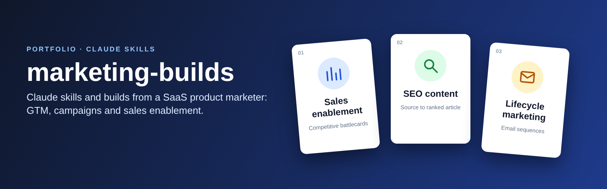
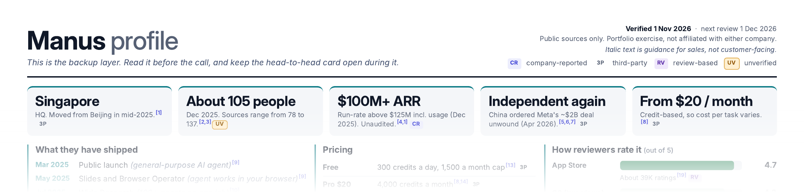

# marketing-builds

**Claude skills and builds from a SaaS product marketer.** Each folder is a working project: a skill you can add to Claude, plus a real worked example.

## About me
Senior PMM, 9 years in B2B/B2C SaaS, with the builds aimed at GTM, campaign management and sales enablement.

## Projects

| # | Project | What it does | Status |
|---|---------|--------------|--------|
| 01 | [Competitive battlecard generator](01-competitive-intel/) | Turns two company names into a fully sourced, sales-ready battlecard PDF. Worked example: Genspark vs Manus. | Live |
| 02 | SEO content engine | Turns a proven X post or YouTube video into a credited, SEO-optimised article, using free tools. | Coming soon |
| 03 | Lifecycle email builder | Builds a full lifecycle email sequence with timing, branching and copy. | Coming soon |

## How to use these skills
1. Open a project folder and download it (on GitHub: Code, then Download ZIP).
2. In Claude, go to Settings, then Capabilities, then Skills, and upload the project folder as a zip. Or paste its `SKILL.md` into a Claude Project's instructions.
3. Ask Claude to run it. Each project's README has an example prompt.

No coding needed. Each skill explains what it will ask you and what it produces.

## Contact
- LinkedIn: [Vernika Bhatia](https://www.linkedin.com/in/vernika-bhatia-9ab783117/)
- Email: vernika.bhatia23@gmail.com

## License
MIT. See [LICENSE](LICENSE). Company names and logos in examples belong to their owners and are shown for illustration only. Examples use public information, are portfolio exercises, and are not affiliated with the companies named.
